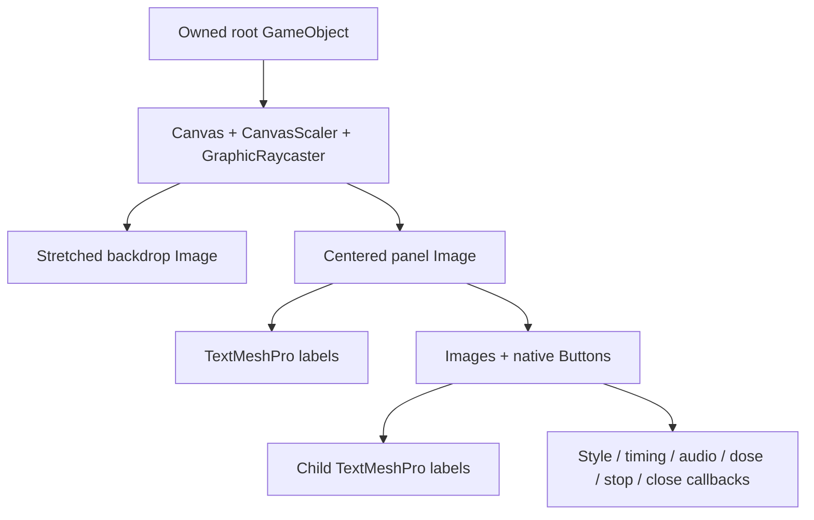

# Comparison menu: visual direction and reusable construction

The comparison panel is a quiet, readable control surface over the game. Its job is to make a short experiment easy: choose a style, choose how time behaves, start a tier, then return to the scene. The game remains visible behind it, so the panel feels like part of the playtest rather than a separate launcher.

This document describes the current **0.2.0** panel. The implementation is `src/S1LSDComparison/ComparisonPanel.cs`; state, shortcuts and input ownership live in `S1LSDComparisonMod.cs`.

## Visual direction

Use a dark blue-black panel, pale text and one muted teal accent. Selected buttons use teal; unselected buttons use a slate fill. Selection is a persistent state, while hover brightens the fill and pressing temporarily darkens it. All controls have visible backgrounds, so a button cannot be mistaken for a plain label.

| Element | Current value | Purpose |
| --- | --- | --- |
| Backdrop | Black, alpha 0.60 | Keep context while reducing background competition |
| Panel | RGB 0.035 / 0.055 / 0.080, alpha 0.99 | A stable reading surface |
| Unselected button | RGB 0.12 / 0.18 / 0.24 | Clear clickable rectangles without competing accents |
| Selected button | RGB 0.12 / 0.46 / 0.42 | Show the active choice |
| Text | RGB 0.92 / 0.96 / 0.98 | High contrast without pure white |
| Hover multiplier | RGB 1.3 / 1.3 / 1.3 | Immediate pointer feedback |
| Press multiplier | RGB 0.7 / 0.8 / 0.8 | A visible pressed state |

The palette is intentionally restrained. The effects themselves supply color and movement; the menu supplies a stable hierarchy. There are no decorative ribbons, gradients, icons, moving accents or custom textures.

The layout reads from decision to action: title and one instruction; style; timing; four equal dose buttons; audio on/off; supporting duration information; current status; Stop and Close. Pairs are easier to compare when they occupy equal columns. Dose choices are parallel actions, so all four receive the same dimensions and prominence. Stop ends the experience; Close returns to viewing it. Those actions stay separate.

Keyboard hints appear inside the control labels, such as `CLASSIC · C`. That avoids a separate shortcut legend and makes the fallback discoverable at the point of use. In 0.2.0, audio can change during an active preview; changing style or timing applies on the next dose selection.

## Layout recipe

The first panel was 760 × 540 reference pixels. Adding the audio row made the current panel **760 × 600**. The outer margin is 28 pixels. Two-column controls are 340 pixels wide with a 24-pixel gap. Buttons are 48 pixels tall; dose buttons are 164 × 58 with 16-pixel gaps. The title is 27-point, standard button/instruction text is 19-point, and supporting text is 17–18-point.

The Canvas scales against a **1920 × 1080** reference with a width/height match of 0.5. The panel is centered; its children use top-left anchors and pivots. Thus their positions are ordinary `(x, -y)` offsets from the top-left of the panel. The backdrop stretches to all four screen edges.

```text
Title
Instruction
[ Classic              ]  [ Subtle                ]
[ Hold peak            ]  [ Full timeline         ]
[ 70 ] [ 140 ] [ 280 ] [ 360 ]
[ Audio on             ]  [ Audio off             ]
Durations
Status
[ Stop comparison      ]  [ Close panel           ]
```

For another mod, keep the spacing and hierarchy but replace the choices with that mod's real decisions. A shop, placement tool or tuning panel will need different action labels. Keep an instruction short enough to explain what the next click does.

## How the panel is built

This uses Unity **uGUI**, the game's existing EventSystem and TextMeshPro. The root owns a screen-space overlay Canvas, CanvasScaler and GraphicRaycaster. The Canvas sorting order is 300 so it draws over the normal scene UI. The backdrop and panel are Images. Each button is an Image plus a native Button; its child label is TextMeshProUGUI.



`Rect(...)` creates an owned GameObject with a RectTransform, assigns its parent with `worldPositionStays=false`, and sets its anchors, pivot, position and size. `Label(...)` builds on that rectangle. Labels have `raycastTarget=false`, so they never intercept the button underneath. `Button(...)` adds the fill, assigns it as `targetGraphic`, configures the ColorBlock, centers the label and connects the callback.

Schedule I uses IL2CPP. Component creation therefore uses `Il2CppType.Of<RectTransform>()`, and a managed callback must be converted into the game's native UnityAction before it can be registered:

```csharp
button.onClick.AddListener(
    DelegateSupport.ConvertDelegate<UnityAction>(action)
    ?? throw new InvalidOperationException("Could not bind a button."));
```

When creating callbacks in a loop, capture a separate local value for each iteration. Otherwise several buttons may accidentally refer to the last loop value. The dose row does this with `var value = doses[i]`.

The current panel uses `Navigation.Mode.None`: mouse and explicit shortcuts drive it. Controller navigation is not implemented. For a future controller-ready panel, add explicit navigation links and test selection/focus feedback as well as mouse hover.

## State and input ownership

The panel displays state; the mod owns it. Style, timing and audio selection are ordinary fields. The panel's callbacks update those fields and refresh the selected colors. A dose callback queues a request, and the mod processes it in Update, avoiding renderer/audio teardown inside an EventSystem callback. Status text updates only when its value changes.

Opening the panel records the previous camera-look, movement, hotbar, equipping and typing states. It registers its own active UI key with PlayerCamera, disables world look/movement/inventory input and releases the mouse. Raw keyboard shortcuts remain available to the mod while the panel is open. Closing hides the root, removes its UI key and restores the recorded values. Mouse locking respects other active game UI.

Do not assume the correct previous state was always “enabled.” A mod may already have disabled movement or equipping. Restore the values that were captured on opening. Also handle Stop, failed preview startup, scene unload and mod shutdown; the panel should never strand the cursor or movement controls.

All created objects belong to this panel. Hide the root between uses, and destroy it when its scene is unloaded or the mod is deinitialized. Constructor failure destroys a partial root. No native game Canvas, font asset or material is edited or destroyed.

## Lessons from the first version

The original immediate-mode panel reached `GUILayout.Toolbar`, then threw `Method unstripping failed` in `GUIContent.Temp(string[])`. The first labels appeared, but the exception prevented all later controls from drawing. This explains the user seeing only dosage labels.

Native uGUI avoids that stripped helper and uses controls already supported by the game. The build now rejects GUI/GUILayout/GUIContent references in this mod and requires Button, GraphicRaycaster and TextMeshPro types. A successful build is still only one check: inspect the panel in the real game, click a selection, start an effect and confirm the requested state in the log.

In the live 0.1.1 check, native selection colors changed, clicking tier 70 started rendering, the full timeline completed, and tier 360 also started. Some individual buttons and automation keyboard inputs were not independently verified. The extra 0.2.0 audio row follows the same native Button factory; its live audio path has a separate final-listener diagnostic described in `s1lsd-comparison.md`.

The comparison shader processes the completed frame, including this menu. At a strong tier its text can acquire fringes or movement. A reusable menu for a different mod should usually remain readable during effects: decide explicitly whether it belongs before or after post-processing. This panel is intentionally part of the visual comparison.

Keep the helpers small until a second mod actually needs them. The current Rect/Label/Button methods can be extracted into a shared UI utility later, along with an input lease, without making the experimental comparison a dependency of other mods.
