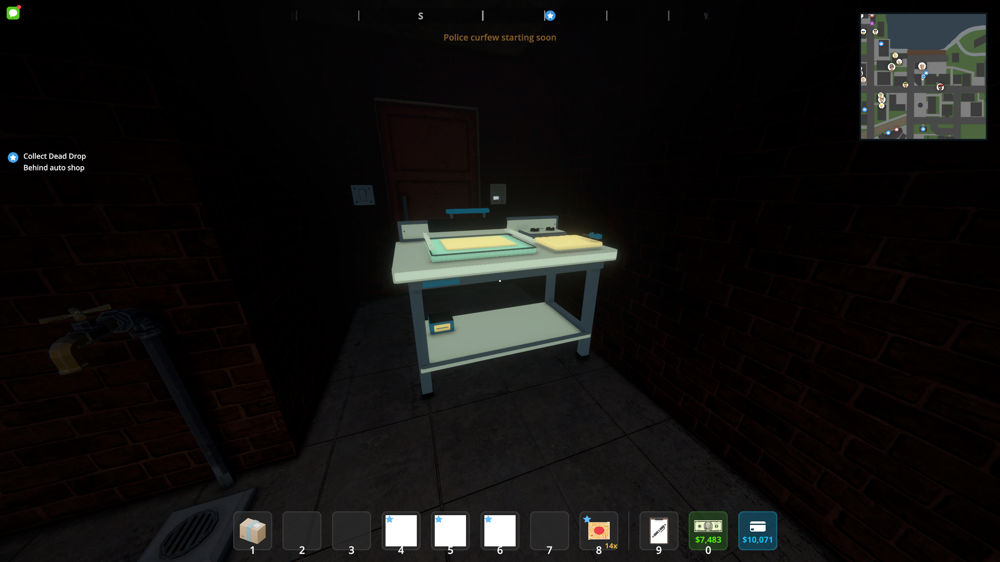
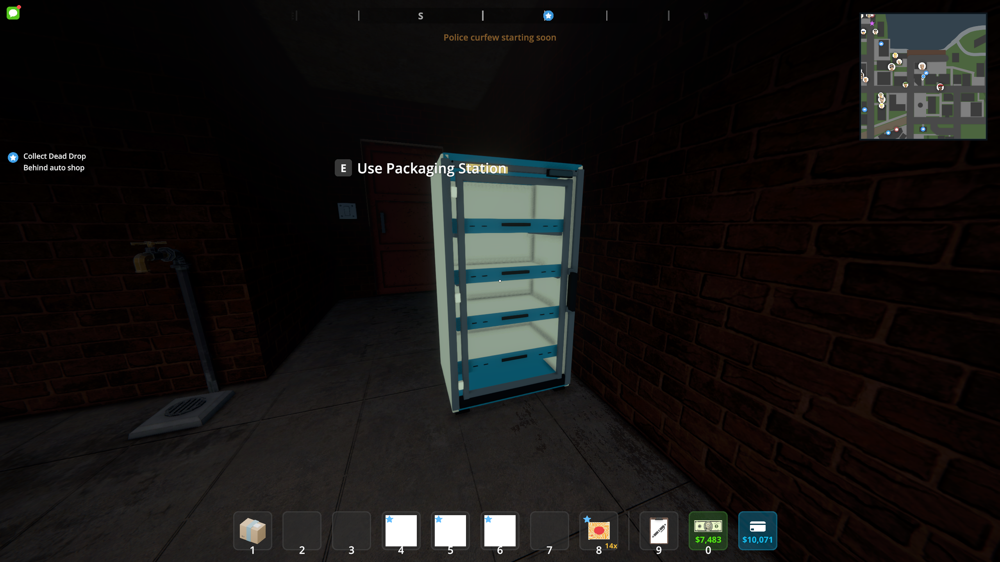
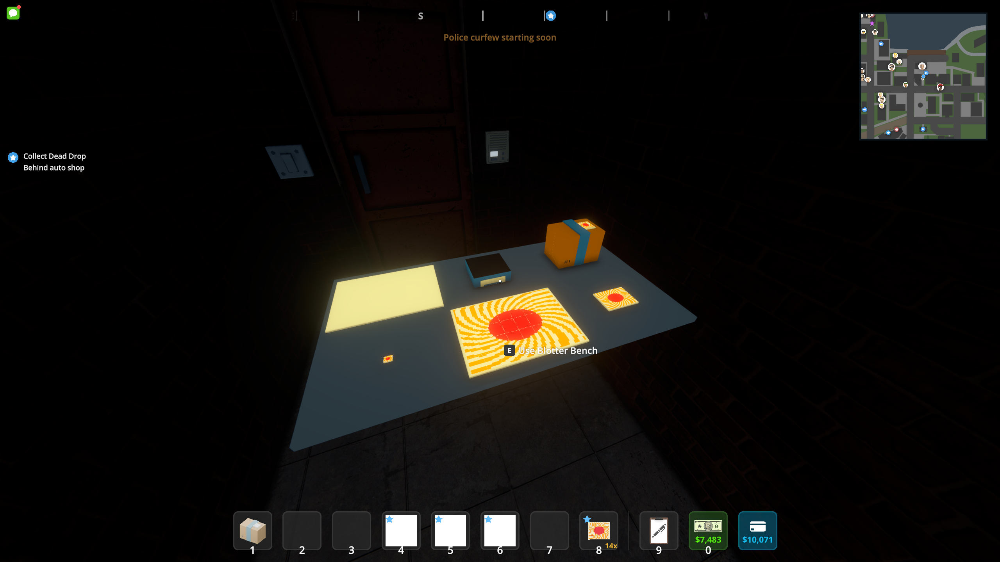
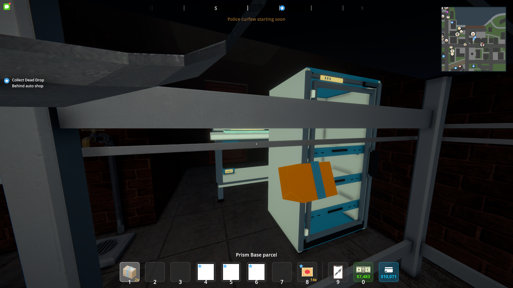
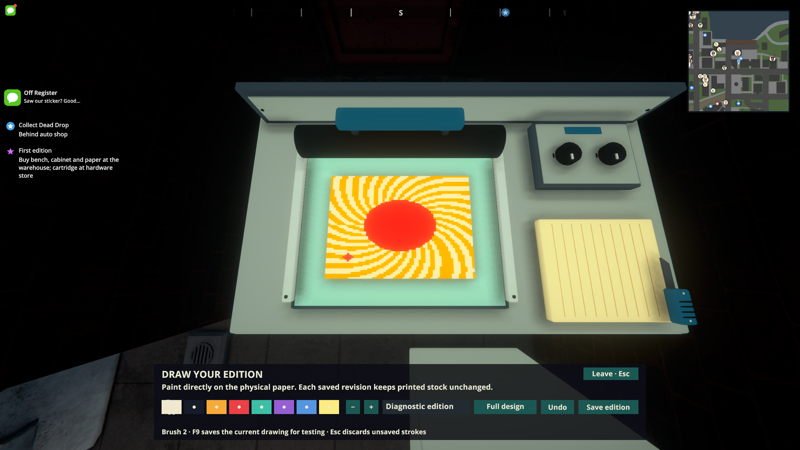
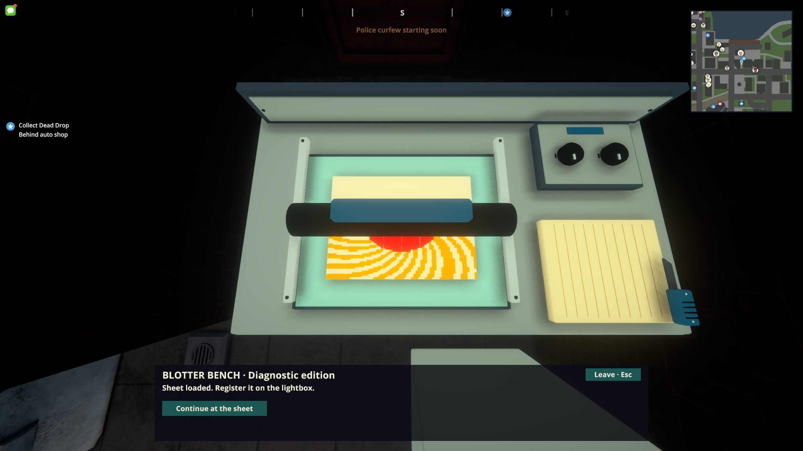
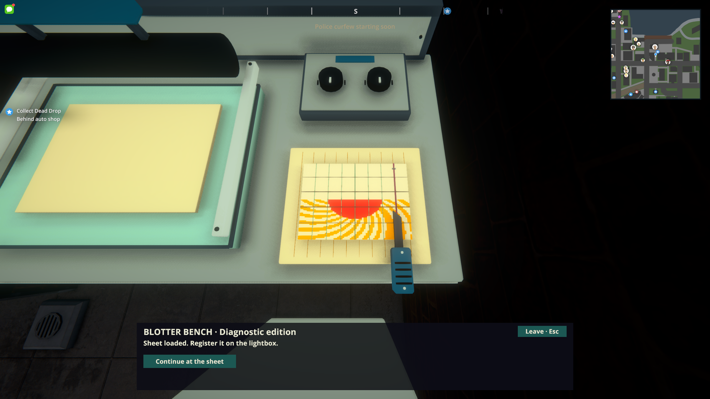

# Off Register models: Unity and in-game verification

Workshop **0.2.4**, checked October 7, 2026 against Schedule I **0.4.7f11 / IL2CPP**, MelonLoader **0.7.3**, S1API **3.2.1-beta.7**, and Unity **2022.3.62f2**.

The six authored models come from [draft art PR #1](https://github.com/Axl47/ScheduleOne-Mods/pull/1), source commit `0115376f1c853d23e63cdea4aa6f77c60dda22e9`. Their committed FBX exports passed the Blender 5.2 model checks, then the licensed Unity editor imported them and rebuilt the real prefabs, palette materials and Windows `studio.bundle`. The installed gameplay DLL embeds this rebuilt bundle and the replacement inventory icons.

`main` did not contain the workshop gameplay. This integration also includes the first playable slice and its consumption/F9 hooks in the existing preview module, so the models can be used after merging. Other VICE modules, comparison tools and TV development are outside this PR.

## Live screenshots

These are unchanged screenshots captured by the running game, using its URP shader. They are distinct from the [Blender review renders](lsd-art-polish.md). The furniture pictures temporarily hide neighboring placed equipment to avoid obstructing the camera. The small-item picture uses actual registered stored-item prefabs and a temporary review tabletop; those fixtures are not saved. Artwork comes from the loaded workshop edition.

### Blotter Bench



### Drying cabinet



### Item representations



### Equipped precursor

The visual check found that the old held template's inactive root was cloned inactive. The template now stays active beneath a disabled cache and uses the native Viewmodel layer. Prism Base keeps its parcel ID and illegal status.



### Physical drawing, printing and cutting





The last two images are diagnostic geometry views. The saved batch is at registration, so the toolbar still describes that state while the checker positions the roller or knife. The native checks also completed the actual production interactions.

## Verified

- All six `.blend` sources and six FBX exports pass names, UVs, bounds, material assignments and animation contracts; live imported meshes have supported shaders and the new `StaticDetails` geometry.
- Unity rebuild succeeds with the new palette and generates the committed prefabs/materials/bundle. Compilation passes with warnings treated as errors; workshop rules and 132,983 preview assertions plus compiled render/audio guards pass.
- Native exercise completes drawing, registration, printing, drying, eleven cuts, 40-tab collection, capacity rejection, tutorial progression, native baggie/jar/sleeve packing and sealing, consumption and saving.
- Separate native reload preserves editions, equipment, package counts, unfinished production, tutorial progress and the delivery ledger.
- Geometry checks verify screen-up printing/reveal, roller alignment, blade/grip motion across all eleven cut lines, sheet icons, tolerant pointer projection and restored hotbar controls.
- Native physics checks accept 15 released tabs through real trigger contacts across five baggies and two five-tab jars, then seal with exact output counts. Held tabs are rejected, and ordinary native packaging retains its original timing.
- The original fifth save slot is restored afterward, with all **47 file hashes** matching its pre-test backup. Backups, native logs and test saves remain local under ignored `artifacts/native-art-check`.

See [the recorded build and asset hashes](lsd-art-integration.json). Multiplayer and performance profiling were not exercised. The native icon rig still reports its existing custom-sleeve composite-icon fallback; this does not prevent sleeve packaging or its world representation.

## Reproduce

Build with `scripts/Build-LSDGameplay.ps1`; use `-RebuildArt` only when regenerating the Blender assets as well. The normal build packages both DLLs as `artifacts/LSDGameplay-0.2.4.zip`.

With the game closed, back up slot five before using any native diagnostic. Supply an absolute output path, for example:

```text
--lsd-slice-check --lsd-slice-exercise --lsd-art-check --lsd-check-output=C:\WorkshopChecks
--lsd-slice-check --lsd-slice-reload --lsd-check-output=C:\WorkshopChecks
--lsd-slice-check --lsd-sheet-check --lsd-packaging-check --lsd-check-output=C:\WorkshopChecks
--lsd-slice-check --lsd-art-gallery --lsd-check-output=C:\WorkshopChecks
```

Exercise mode places equipment and saves diagnostic production state. The other modes expect equipment already present; gallery mode temporarily stages stored views and equips a parcel. Restore the backed-up save after testing. These modes only accept slot five and are opt-in; ordinary play does not run them.
