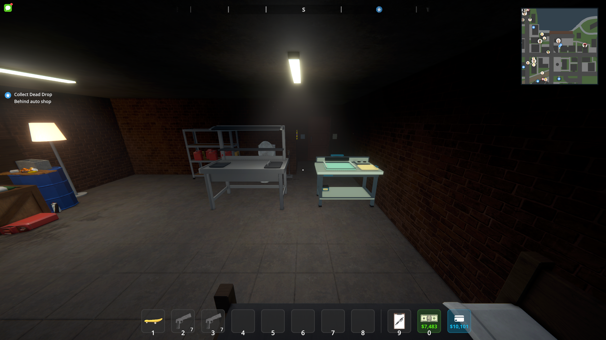
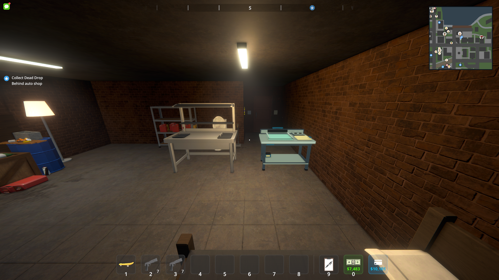
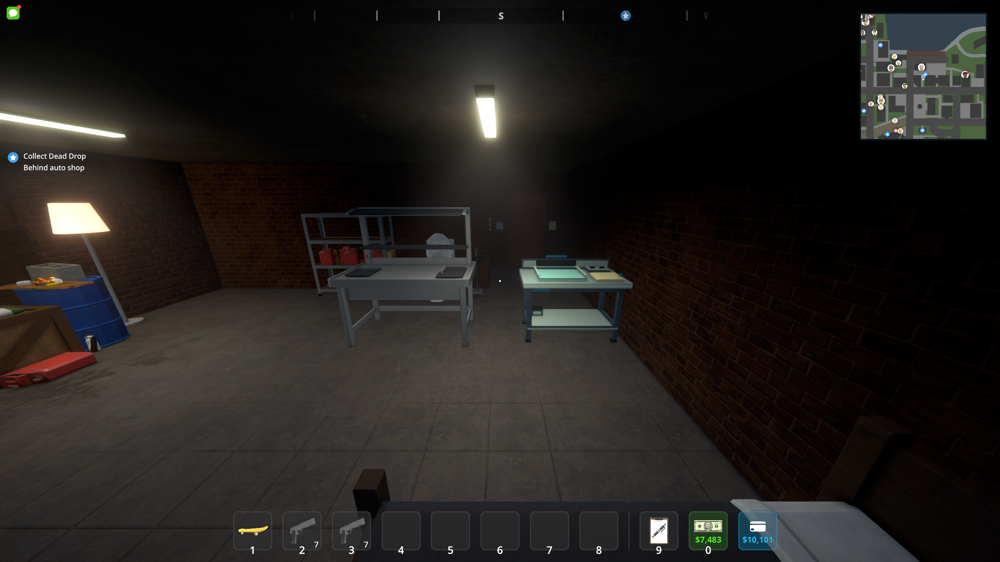
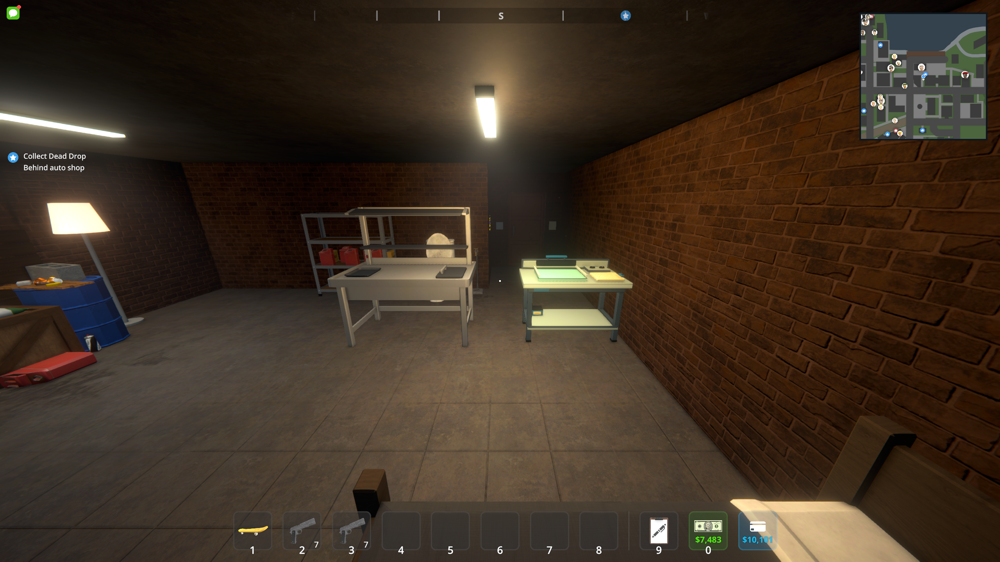
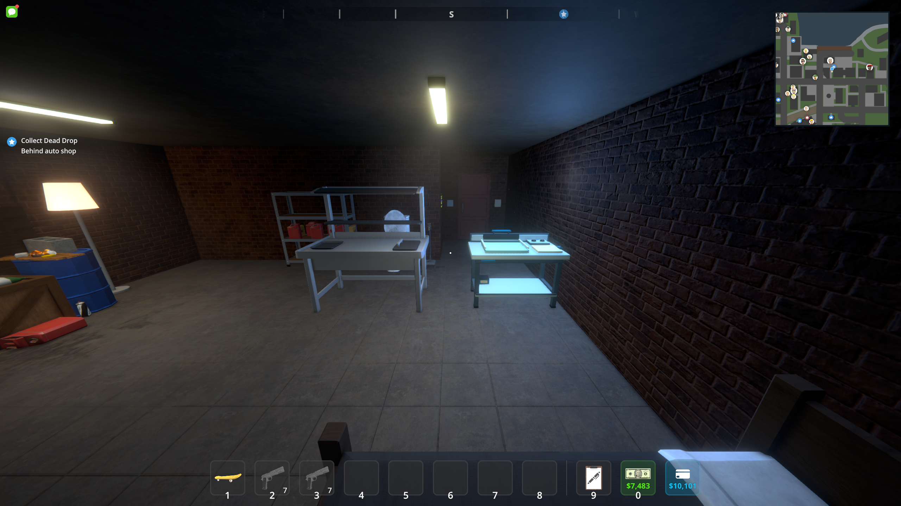

# Off Register models: Unity and in-game verification

Workshop **0.2.4**, checked October 7, 2026 against Schedule I **0.4.7f11 / IL2CPP**, MelonLoader **0.7.3**, S1API **3.2.1-beta.7**, and Unity **2022.3.62f2**.

The six authored models come from [draft art PR #1](https://github.com/Axl47/ScheduleOne-Mods/pull/1), source commit `0115376f1c853d23e63cdea4aa6f77c60dda22e9`. Their committed FBX exports passed the Blender 5.2 model checks, then the licensed Unity editor imported them and rebuilt the real prefabs, palette materials and Windows `studio.bundle`. The installed gameplay DLL embeds this rebuilt bundle and the replacement inventory icons.

`main` did not contain the workshop gameplay. This integration also includes the first playable slice and its consumption/F9 hooks in the existing preview module, so the models can be used after merging. Other VICE modules, comparison tools and TV development are outside this PR.

## Live screenshots

These are unchanged screenshots captured by the running game, using its URP shader. They are distinct from the [Blender review renders](lsd-art-polish.md). The furniture pictures temporarily hide neighboring placed equipment to avoid obstructing the camera. The small-item picture uses actual registered stored-item prefabs and a temporary review tabletop; those fixtures are not saved. Artwork comes from the loaded workshop edition.

### Blotter Bench


### Drying cabinet


### Item representations


### Equipped precursor

The visual check found that the old held template's inactive root was cloned inactive. The template now stays active beneath a disabled cache and uses the native Viewmodel layer. Prism Base keeps its parcel ID and illegal status.


### Physical drawing, printing and cutting


The last two images are diagnostic geometry views. The saved batch is at registration, so the toolbar still describes that state while the checker positions the roller or knife. The native checks also completed the actual production interactions.

## Verified

- All six `.blend` sources and six FBX exports pass names, UVs, bounds, material assignments and animation contracts; live imported meshes have supported shaders and the new `StaticDetails` geometry.
- Unity rebuild succeeds with the new palette and generates the committed prefabs/materials/bundle. Compilation passes with warnings treated as errors; workshop rules and 132,983 preview assertions plus compiled render/audio guards pass.
- Native exercise completes drawing, registration, printing, drying, eleven cuts, 40-tab collection, capacity rejection, tutorial progression, native baggie/jar/sleeve packing and sealing, consumption and saving.
- Separate native reload preserves editions, equipment, package counts, unfinished production, tutorial progress and the delivery ledger.
- Geometry checks verify screen-up printing/reveal, roller alignment, blade/grip motion across all eleven cut lines, sheet icons, tolerant pointer projection and restored hotbar controls.
- Native physics checks accept 15 released tabs through real trigger contacts across five baggies and two five-tab jars, then seal with exact output counts. Held tabs are rejected, and ordinary native packaging retains its original timing.
- The original fifth save slot is restored afterward, with all **47 file hashes** matching its pre-test backup. Backups, native logs and test saves remain local under ignored `artifacts/native-art-check`.

See [the recorded build and asset hashes](lsd-art-integration.json). Multiplayer and performance profiling were not exercised. The native icon rig still reports its existing custom-sleeve composite-icon fallback; this does not prevent sleeve packaging or its world representation.

## PR review follow-up

The review of `31b7193` identified seven additional gameplay issues. The follow-up tracks actual local consumption events so repeated uses from one stack refresh the effect; retries pending actions after panel close and releases their leases after replies; exempts idempotent releases from action throttling and save/death restrictions; clears owned camera overrides independently of equipment validity; resets print textures, pixels, coverage and direction between batches; displays order replies in the phone catalogue; and observes all loaded player inventories for the shared tutorial.

The follow-up passes warning-free workshop and preview builds, workshop persistence/rule checks, **132,988** preview assertions (including repeated consumption from the same stack), and the compiled rendering/audio guards. The opt-in native sheet diagnostic now also checks multiple consecutive editions and repeated batches in one sheet view. The follow-up build loaded successfully for the lighting comparison below; the seven review scenarios have not been re-exercised in that run or in multiplayer. The screenshots and JSON hashes above record the original art verification build; the follow-up build and its later installation are recorded separately below.

## Lighting follow-up

The Blotter Bench originally used native URP **Unlit**, so the room's lights could not shade its authored surfaces. All six physical model families, artwork and sheet materials now use the game's supported URP **Lit** shader. Material binding checks actual cached renderers, including inactive artwork planes, rather than assuming a model name means every material is already bound. Cut and drawing guides keep their readable unlit material.

The live Packaging Station supplied the lighting reference: receive shadows enabled, environment reflections disabled, nonmetallic surfaces, and matching shadow casting, light probes, reflection probes and rendering layers. Studio materials retain their authored colors and textures, with low gloss for paper, painted metal and enamel. The authored geometry and bundle are unchanged; this correction binds the game's own compiled shader at runtime.

The native test places a real Blotter Bench on the right and a real Packaging Station on the left, then captures one fixed view under room lighting, a warm point light and a cool side light. The following PNGs are unchanged game captures. Before the fix, the bench remains nearly identical when the warm light is enabled; afterward, both pieces of furniture respond to the lights. Their different materials, positions and geometry still produce different brightness.

Before, room lighting:



Before, warm light:



After, room lighting:



After, warm light:



After, cool side light:



Native assertions verify supported Lit bindings on all six model families and matching live bench/station renderer settings. Five projected tabletop sample locations, each averaged over a 5 by 5 pixel patch, measure the warm-light change per RGB channel: bench **0.03 before / 72.51 after**, Packaging Station **36.35 before / 36.48 after** (0–255 scale). This demonstrates response to lighting, not equal reflectance between different surfaces. See [the lighting build hashes and measurements](lsd-lighting-check.json).

The test used a workspace-local MelonLoader profile and an isolated copy of slot five. No saving occurred; all **47** copied save files still match the original backup. That diagnostic did not replace the normal installed DLL. The rebuilt package passes all workshop rule/persistence checks, **132,988** preview assertions and compiled render/audio guards with no compiler warnings.

After full filesystem access was enabled on October 7, the game was confirmed closed and both packaged DLLs were installed into its normal `Mods` directory. Installed gameplay and preview hashes match the verified package. The previous DLLs were backed up under ignored `artifacts/lighting-install-backup-*`; no save files were changed during installation.

To reproduce the lighting comparison, place a copy of the save directory at `<output>/SaveGame_5`, stage the built DLLs in a separate MelonLoader base directory, then launch the game with:

```text
--melonloader.basedir=<isolated-loader-directory> --lsd-slice-check --lsd-lighting-check --lsd-lighting-verify --lsd-check-output=<absolute-output-directory>
```

The checker refuses registered native save folders, places temporary furniture, captures three images and exits. Use distinct output directories for the old and fixed builds, then run:

```powershell
scripts/Check-LSDLighting.ps1 -BeforeDirectory <old-output> -AfterDirectory <fixed-output>
```

## Reproduce

Build with `scripts/Build-LSDGameplay.ps1`; use `-RebuildArt` only when regenerating the Blender assets as well. The normal build packages both DLLs as `artifacts/LSDGameplay-0.2.4.zip`.

With the game closed, back up slot five before using any native diagnostic. Supply an absolute output path, for example:

```text
--lsd-slice-check --lsd-slice-exercise --lsd-art-check --lsd-check-output=C:\WorkshopChecks
--lsd-slice-check --lsd-slice-reload --lsd-check-output=C:\WorkshopChecks
--lsd-slice-check --lsd-sheet-check --lsd-packaging-check --lsd-check-output=C:\WorkshopChecks
--lsd-slice-check --lsd-art-gallery --lsd-check-output=C:\WorkshopChecks
```

Exercise mode places equipment and saves diagnostic production state. The other modes expect equipment already present; gallery mode temporarily stages stored views and equips a parcel. Restore the backed-up save after testing. These modes only accept slot five and are opt-in; ordinary play does not run them.
