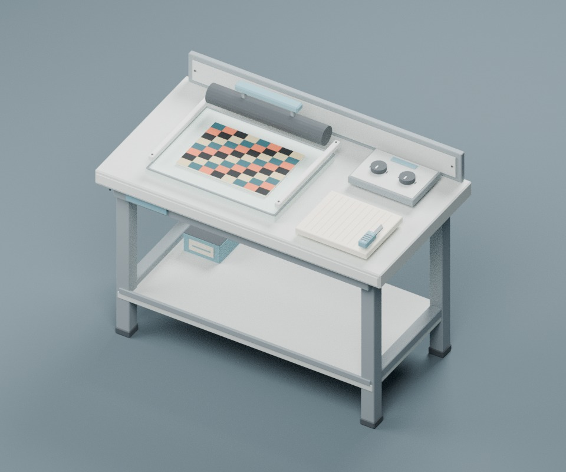
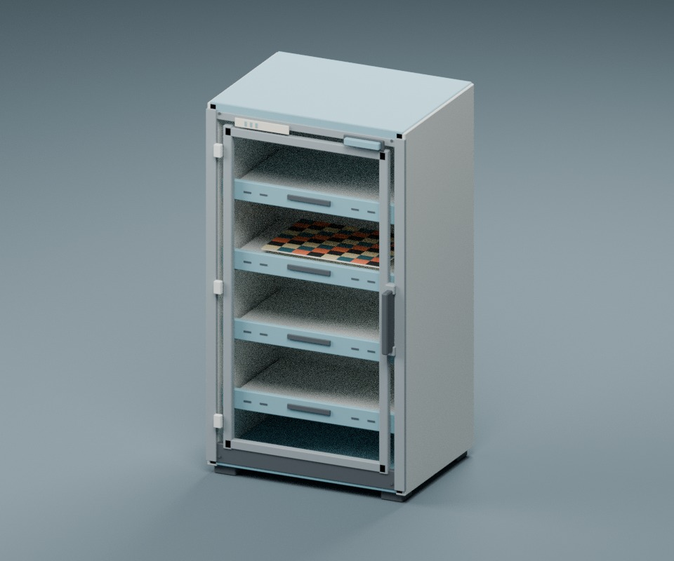
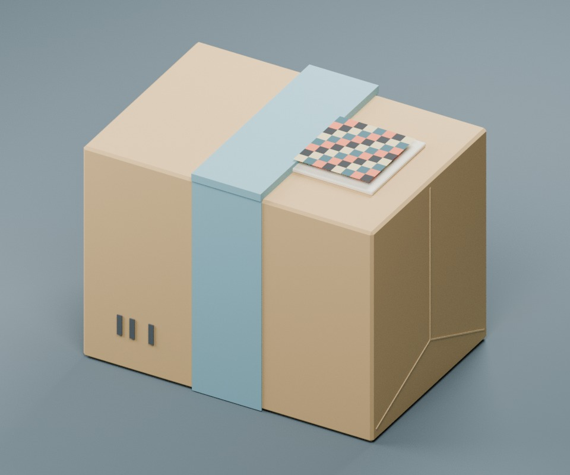
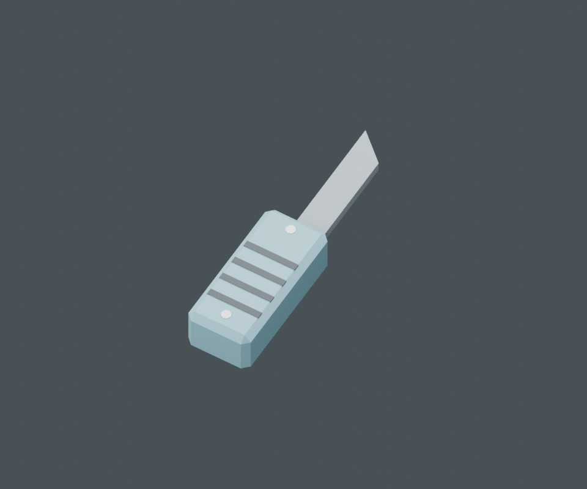

# Off Register: authored prop polish

This art pass targets `codex/lsd-playable-slice` and the existing six-model studio pipeline. It does not change production rules, recipes, inventory quantities, placement footprints, save IDs, or minigame behavior.

## Review renders

These are **Blender CPU renders of the committed meshes**, not in-game screenshots. The checkerboard artwork is an illustrative preview only; the game still supplies the player's saved edition. Lighting, shadows and material response in these renders differ from the game's current URP/Unlit binding.







## What changed

- **Bench:** restrained sheet-metal/enamel worktop, folded apron/backstop, braced square frame, rubber feet, framed lightbox, roller collars/supports, readable dial indices and a marked cutting mat
- **Cabinet:** folded frame, metal tray runners, recessed pulls/vents, cap and kickplate, hinges, handle mounts and lamp bezel. The front stays open so the existing opaque shader does not conceal the printed sheet behind fake glass
- **Knife:** tapered blade with a distinct edge face, chamfered grip, ribs and pins. Details belong to the two existing animated meshes; nothing is left behind during cutting
- **Parcel / Prism Base:** ochre kraft, slate-blue wraparound tape, folded-end seams, label backing and simple original handling marks. `Content.cs` uses **Parcel** for Prism Base; there is no separate crystal/prism model to replace
- **Packet / envelope sleeve:** an inset reverse-side triangular flap and fold seams, kept inside its existing bounding box. The front remains reserved for the edition artwork. The sleeve inventory icon now shows its reverse so it reads as an envelope
- **Sheet and Tab:** retained artwork UVs and sizes, clean single-step paper-edge bevels. Runtime artwork/perforation grids continue to be generated by the game code
- **Ink cartridge:** joined cap, label and stripe survive the runtime's single-renderer supply selection
- **Static batching:** decorative pieces are joined into `StaticDetails`; the bench uses 10 mesh renderers and cabinet 4. Animated/toggled/isolated supply meshes stay separate. The disconnected components remain editable in Blender Edit Mode. This reduces renderer overhead; actual game performance still needs profiling.

All geometry is original and generated by `scripts/Build-LSDStudio.py`. All six editable `.blend` files, matching FBXs and six transparent inventory icons are retained. No reference screenshots, downloaded meshes, copied logos or game assets are included.

## Visual references

Viewed October 7, 2026. These are appearance references, not dimension or shader specifications:

- [TVGS: Mixing Station Mk II announcement](https://steamcommunity.com/ogg/3164500/announcements/detail/524208404882785060): simple utilitarian gray cabinet forms, muted blue accents and restrained bevels
- [TVGS: Packaging Station Mk II announcement](https://store.steampowered.com/news/app/3164500/view/524207137294910452): clear tray/workbench construction and readable industrial controls
- [TVGS: storage closet announcement](https://steamcommunity.com/games/3164500/announcements/detail/541129246577264261): pale sheet steel, dark lower sections, inset hardware and pressed-panel seams
- [Shacknews / Aidan O'Brien game screenshot](https://d1lss44hh2trtw.cloudfront.net/assets/editorial/2025/04/schedule-i-screenshot-20250410-00035160.jpg): ochre kraft storage boxes with broad slate-blue tape
- [FrankGamer workstation screenshot](https://frankgamer.com/wp-content/uploads/2025/03/Schedule-1-workstations-at-sweatshop-1024x686.png): slab work surface, straightforward legs and lower shelf

The palette uses large flat color regions because runtime copies only material color and main texture into URP/Unlit. PBR roughness/metallic, transparency, emission or baked scene lighting are not assumed to survive import. `BuildStudio.cs` now explicitly maps every new palette name rather than silently rendering it white.

## Rebuild and checks

Tested authoring environment: **Blender 4.3.2, Linux x86-64, Cycles CPU**. Optional denoising is disabled for builds without OpenImageDenoise. The scripts require no external Python packages.

```sh
blender --background --factory-startup --python-exit-code 1 --python scripts/Build-LSDStudio.py
blender --background --factory-startup --python-exit-code 1 --python scripts/Check-LSDStudio.py -- --report /tmp/lsd-studio-check.json
blender --background --factory-startup --python-exit-code 1 --python scripts/Render-LSDIcons.py
blender --background --factory-startup --python-exit-code 1 --python scripts/Render-LSDStudioReview.py
```

Generator subsets are supported after `--`, for example `-- Bench Cabinet`. Review renders support `-- Packet` etc. The review script always refreshes the small knife detail. Scripts locate paths relative to themselves; no machine-specific repository path is stored in the assets.

`Check-LSDStudio.py` checks all six `.blend` sources and their FBX round trips, including required runtime names, material/color parity with the Unity builder, finite geometry, sensible triangle budgets, footprint bounds, exact artwork planes/UV corner order, and the cutter/roller bounds used by animation. It also records semantic geometry hashes for deterministic rebuild comparison, ignoring incidental binary-export metadata. A deliberately broken temporary fixture confirmed failure detection. The [recorded validation summary](lsd-art-validation.json) contains counts, bounds and semantic hashes: Bench 2,406 triangles/10 meshes; Cabinet 2,378/4; Parcel 234/4; Packet 95/2; Sheet and Tab 46/2 each. Rebuilding all six models produced identical semantic fingerprints.

### Required Unity/game verification before use

**The checked-in Unity prefabs and `src/LSDGameplay/Assets/studio.bundle` are the previous build. They have deliberately not been edited by hand or represented as rebuilt.** The new FBX/source art is not active in a game package until the normal Unity rebuild runs. Do not package this branch with an ordinary non-`RebuildArt` build and expect the new models.

On the existing licensed Unity **2022.3.62f2** build machine, run:

```powershell
./scripts/Build-LSDGameplay.ps1 -RebuildArt -BlenderPath '<your Blender executable>'
```

This regenerates the sources/icons, runs the new model checks, rebuilds prefabs/materials and the Windows bundle through `BuildStudio.Build`, then runs the repository's existing compilation/rule checks. The Blender invocations now use `--python-exit-code 1` so Python exceptions cannot be mistaken for successful builds. Commit the actual Unity-generated outputs after this step.

Unity, the proprietary game/MelonLoader/S1API assemblies and a .NET SDK were not available in the authoring cloud environment. Consequently the Unity rebuild, PowerShell build, native minigames, packaging/colliders, held-item views and multiplayer have **not** been executed for this art pass. The PR remains a draft until those checks are completed. In a backed-up test save, follow the existing workshop diagnostics to verify all eleven cut strokes, roller travel, artwork orientation, lamp changes, stored supplies, sleeve packaging and Prism parcel pickup/held appearance. Do not infer gameplay correctness from the Blender renders.
