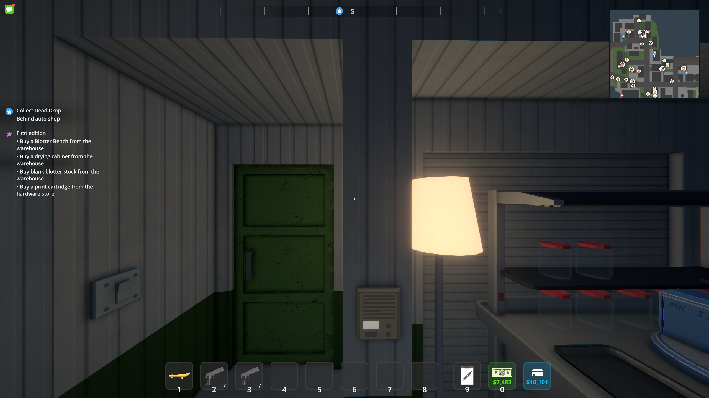
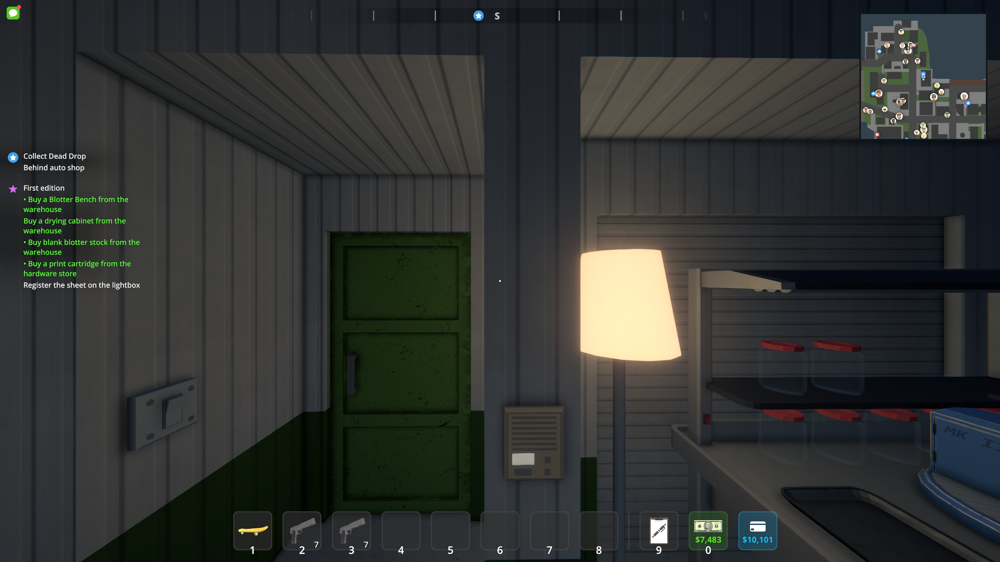
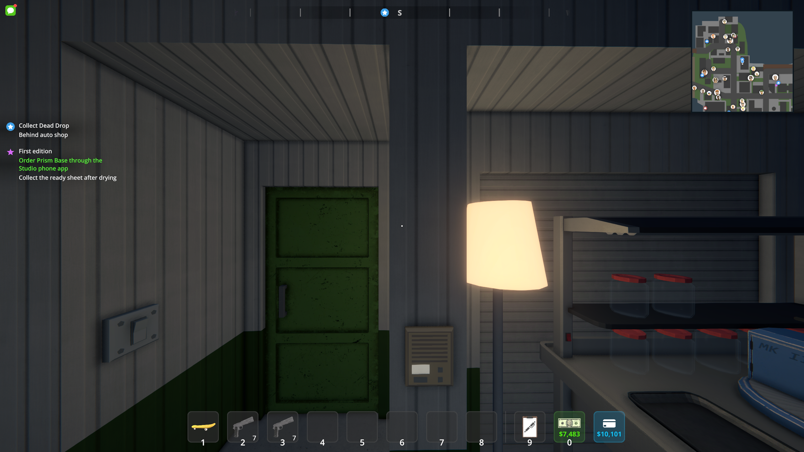

# First edition: individual objectives

Workshop **0.2.5**, checked October 7, 2026 against Schedule I **0.4.7f11 / IL2CPP**, MelonLoader **0.7.3** and S1API **3.2.1-beta.7**.

The old tutorial combined four purchases into one entry and paired several production actions. The native quest now has eighteen entries. Four supply purchases form an initial checklist and the two placement tasks form a second checklist; production then presents one action at a time. Each completed objective stays checked after its item is consumed or moved. Any loaded player's inventory can contribute to the shared host-owned tutorial.

Ordering and collecting Prism Base, registering and printing, collecting and loading each sheet, cutting and collecting tabs are separate tasks. Successful workshop actions record progress immediately, while inventories and equipment provide evidence for existing or interrupted batches. Loading a print batch does not claim that an unpurchased cabinet has been bought or placed.

The save schema remains version 1 with an additive objective mask. Missing masks migrate from the old `TutorialStep`, which still records a compatible coarse milestone. Completed tutorials stay completed. Old native quest labels are refreshed to the new labels after loading; an old drying-stage tutorial resumes at collecting its ready sheet.

Review follow-up: label refresh also runs for completed quests and when the progress mask has not changed. The coarse milestone now represents only a contiguous prefix of completed objectives, so collecting Prism early cannot imply that supplies or equipment placement are complete. Loading a saved objective mask repairs inflated coarse milestones from the initial 0.2.5 build while retaining the actual completed objectives. Regression checks cover every one of the **262,144** possible objective masks and the order-first flow across reload and later placement.

## Native UI evidence

These are unchanged game screenshots from the isolated diagnostic. The checker sets unsaved quest states to exercise the UI; these pictures do not represent another manual production playthrough. Green text is the native completed-entry animation.







## Verification

- Warning-free workshop and preview builds; workshop persistence/rule checks and **132,988** preview assertions plus compiled render/audio guards pass.
- Portable regression checks cover out-of-order purchases, individual equipment placement, order versus collection, each production transition, progress after consumed supplies, repeated observations, all eleven legacy milestones, save/reload and invalid objective bits.
- Native assertions verify eighteen entries, independent purchase completion, a single registration task, separate cutter loading/cutting/collection/packaging, and complete final entry states.
- A second native launch loads an actual nine-entry saved quest structure in a copied slot-five save. Only the copy is configured to represent legacy drying progress. Its loaded eighteen-entry quest has correct labels and the expected active collection task; the remaining UI checks also pass.
- Both isolated save copies retain **47 / 47** original file hashes after their runs. Neither checker saves. Original saves, raw logs and test profiles are not committed. Multiplayer has not been exercised.

The normal build packages `artifacts/LSDGameplay-0.2.5.zip`. To reproduce the native UI check, copy a save into `<output>/SaveGame_5`, stage the built DLLs in a separate MelonLoader profile, and launch:

```text
--melonloader.basedir=<isolated-loader-directory> --lsd-slice-check --lsd-tutorial-check --lsd-check-output=<absolute-output-directory>
```

The checker refuses registered native save folders and exits after its assertions and captures.
