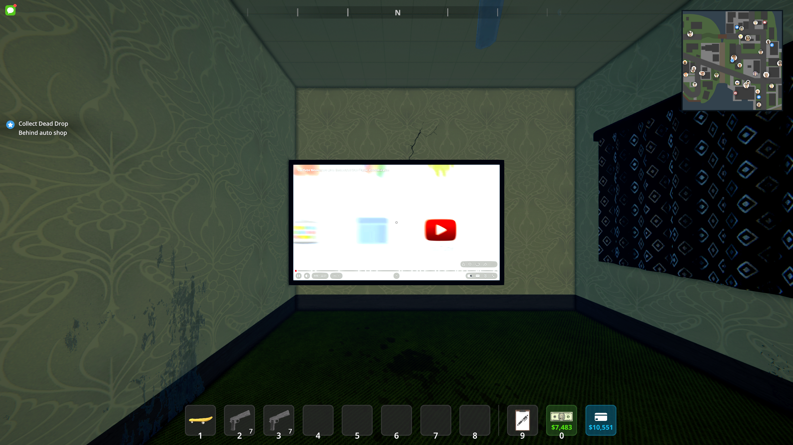
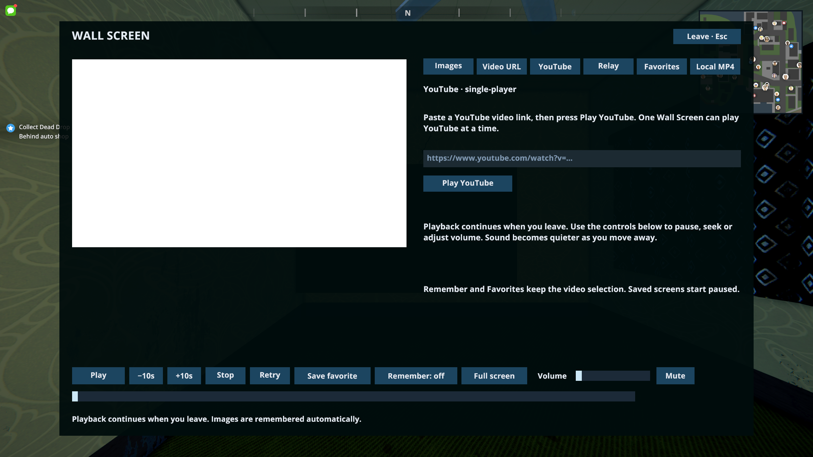
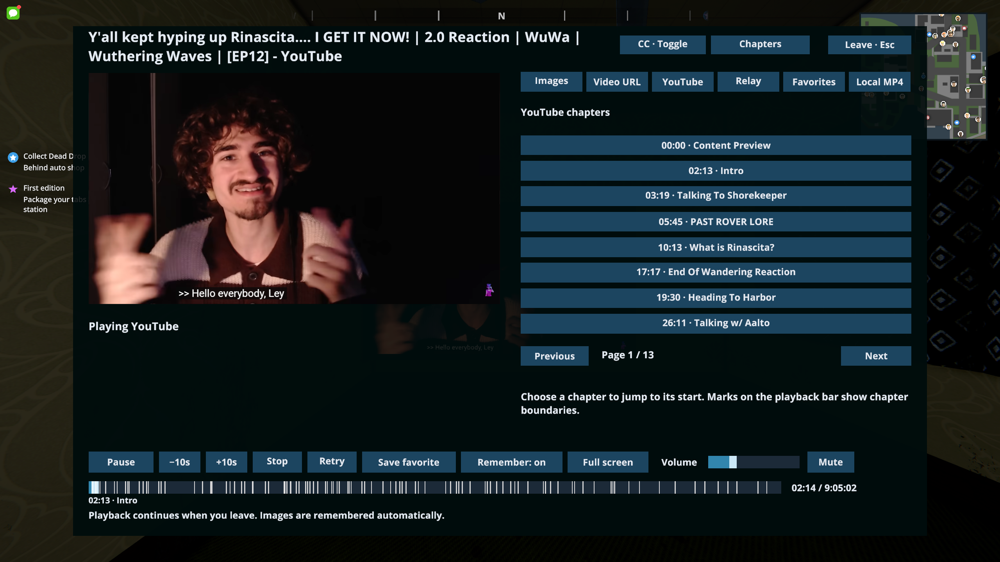
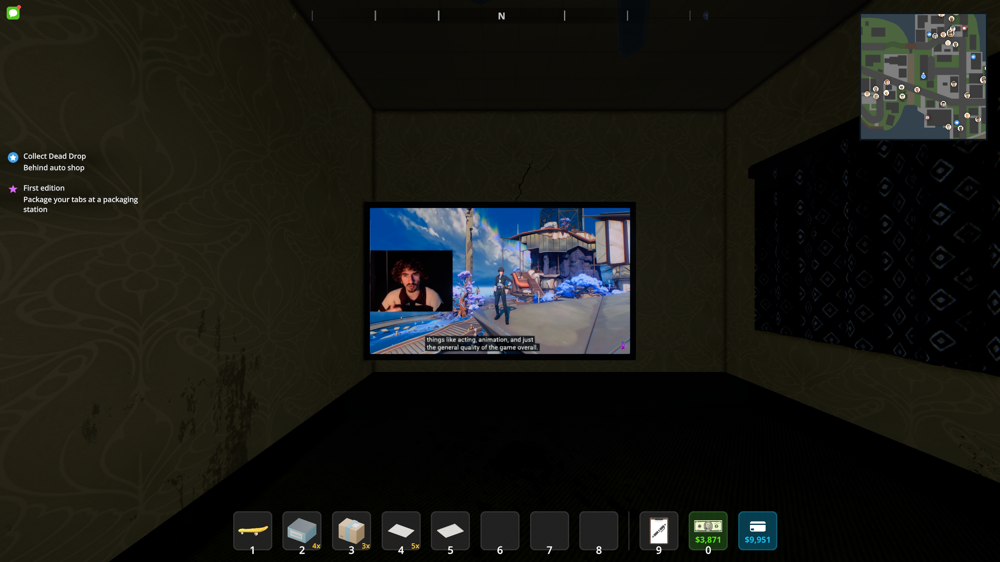
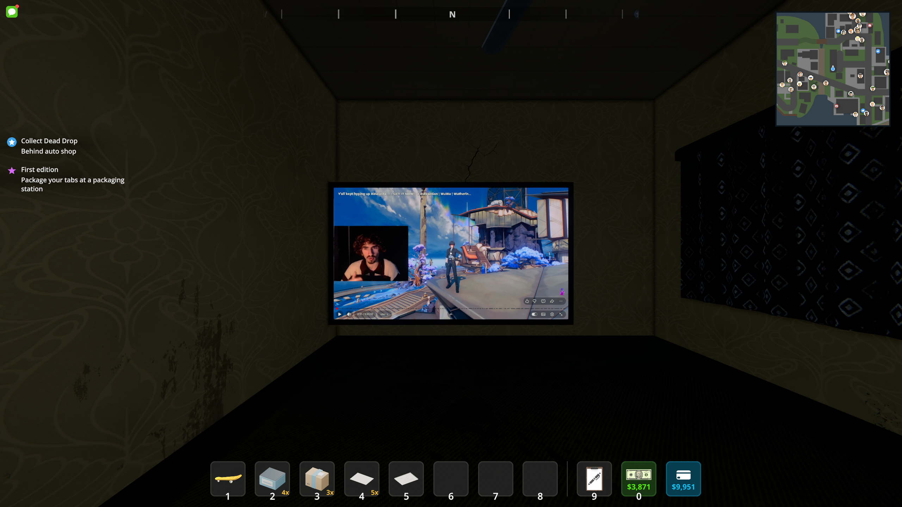

# YouTube on the Wall Screen

VICE Lifestyle 0.1.7 supports **YouTube** on the existing $450 Wall Screen. In single-player, interact with a placed screen, open YouTube, paste a watch/share/short/live link, and select **Play YouTube**. Play/pause, seeking, volume/mute, favorites, Remember, Stop and Retry use the existing controls.

Use **CC · Toggle** at the top of the panel to turn YouTube captions on or off. This sends YouTube's C shortcut to the active player and works while paused, too. The companion does not expose caption state, so the button does not claim captions are currently on or off. Availability and caption language follow the video's tracks and YouTube's player settings.

Chapter boundaries appear as marks on the playback bar, with the current chapter's title beneath it. Open **Chapters** to browse the full list and jump to a chapter's start. Creator chapters take priority over automatic chapters. Chapter loading runs separately from playback; if metadata is unavailable, the video and ordinary seeking continue to work. **Retry** reloads the video and its chapters.

One YouTube screen can be selected at a time. Choosing or starting another clears the previous selection. Playback stops when another player joins. Remember and favorites save the video ID; remembered videos load paused at the beginning. Returning after distance suspension resumes from the last browser position. A live stream or restricted/unavailable video may not support the same controls as an ordinary video.

## Companion installation

This proof of concept uses the **Build-A-Base 0.4.26 IL2CPP TV companion** supplied in the owner's local ZIP. It runs Chromium offscreen and returns 1280×720 BGRA frames to the mod. The separate construction gameplay mod is not needed. Close Schedule I and run:

```powershell
./scripts/Install-TVCompanion.ps1 -Archive 'C:\path\to\Build-A-Base-0.4.26.zip'
```

From an extracted Lifestyle release, the installer is at the package root. Run this command from that root directory:

```powershell
./Install-TVCompanion.ps1 -Archive 'C:\path\to\Build-A-Base-0.4.26.zip'
```

Both new and existing installations are checked against every companion file in the pinned archive, including the executable, CEF dependencies and license files. An incomplete or altered existing installation produces an error rather than reporting success. Preserve or move that directory before rerunning into an empty target.

The script accepts only the inspected archive, checks its SHA-256 and helper DLL, extracts only `UserData/BaseBuilder/TvBrowser`, preserves the bundled third-party license files, and refuses to replace a different existing companion. The extracted dependency is approximately 489 MiB (513,035,918 bytes). Lifestyle exports include this installer, but contain no companion binaries, decompiled source, or construction mod assets.

The inspected archive SHA-256 is `FD0F421D396BEC8E8425486D4B8B6552E8EA0D0AD9443875582118C246B87712`; the helper DLL SHA-256 is `4D39A2EC63F1090E9C65C02F8A9DB457E518975113AE7C4CAFFD87594F3235AB`. This is a personal interoperability adapter; no author redistribution permission was established by the archive inspection.

## Playback behavior

The independently authored adapter starts the installed helper with a random session identity and parent PID. It connects through the helper's named pipe, validates the protocol handshake, sends video IDs and controls, and reads frames under the helper's shared-memory mutex. Browser rows are flipped for Unity's texture orientation. Browser telemetry supplies position, duration and buffering state; old reports cannot undo a newer pause or seek. The ready watch-page player receives the companion's focus/fullscreen input commands.

Chapter lookup reads public player metadata from the selected YouTube watch page, checks its video identity, and uses only the primary player's chapter markers. It does not execute page scripts or turn arbitrary description timestamps into chapters. Requests have a 20-second deadline and 4 MiB limit, with up to 256 chapter entries. Lookup is cancelled and chapter controls cleared when the playback session is released. This metadata format can change independently of the companion, so chapter availability is best effort.

Audio plays through the browser's normal output device. Its gain follows the screen volume, personal volume, game FX setting and distance, fading from full at 2 metres to silent at 22 metres. This proof of concept does not provide directional Unity audio or multiplayer video synchronization. Perceived audio quality has not been verified by an automated listening test.

The helper terminates on Stop, source change, distance/culling suspension, session exit, or pipe failure. Startup and initial media readiness have deadlines, and Retry recreates the session. The helper manages its own Chromium profile, network access and site behavior; playback therefore also depends on YouTube availability and changes to the companion/site integration.

## Validation

`Build-VICE.ps1 -Modules Lifestyle` runs the Core, Lifestyle and module C# checks, native patch-address guard, export hashes and the **VICE module DLL installer** fixture. It does not run the archive-based TV companion installer regression or the native game diagnostic; those are separate manual commands below. The C# YouTube checks cover accepted/rejected links, single-player restrictions, frame layout/orientation, distance gain, protocol parsing (including streams longer than 24 hours within the screen's seven-day limit), browser-owned timing, stale pause/seek reports, timeout/disconnect handling, and paused save/favorite identities.

The opt-in native diagnostic runs against a copied `artifacts/SaveGame_5` save. It places the actual furniture through the native wall-placement handler, selects a link through the source panel, verifies advancing browser frames and video position, then checks pause/resume, seeking, volume, favorites, paused save serialization and helper process cleanup. It captures an actual in-game screenshot:





The corrected native run passed all these checks, and visual inspection confirmed upright video. The run used `artifacts/youtube-oriented-check`; `result.txt` and the local MelonLoader log record `TV_CHECK_PASSED`. Automated validation passed 55 Core assertions, 181 Lifestyle checks, 41 module checks and 12 module-installer fixture checks. The screenshots are unmodified captures from that run.

The separate manual companion installer regression requires the owner's local archive and is not invoked by `Build-VICE.ps1`. It passed six cases: fresh installation, a complete existing installation, a missing executable, a corrupted CEF DLL, a missing license file, and rejection of an unrecognized archive. It uses a disposable game-directory fixture under `artifacts` and deletes that fixture in `finally` on success or failure:

```powershell
./tests/VICE.Lifestyle/Test-TVCompanionInstaller.ps1 -Archive 'C:\path\to\Build-A-Base-0.4.26.zip'
```

Native game invocation (this diagnostic intentionally rejects normal save paths):

```text
Schedule I.exe --tv-system-check=C:\...\artifacts\youtube-check --tv-check-save=C:\...\artifacts\youtube-check\SaveGame_5 --tv-check-youtube=https://www.youtube.com/watch?v=M7lc1UVf-VE
```

The tested link is the YouTube Developers iframe API demo. The proof of concept reuses the existing companion's watch-page playback route; a standalone official iframe-player helper remains a possible later implementation.

For the 0.1.7 controls, the ordinary build passed 55 Core assertions, 198 Lifestyle checks, 41 module checks and 12 installer fixture checks. An opt-in live metadata check (`dotnet run --project tests/VICE.Lifestyle -c Release -- --youtube-chapters-live`) found 100 chapters on the owner's supplied `WJNppjUrmxM` video, including Intro at 2:13. The new checks cover primary-player identity, creator/automatic chapters, malformed and duplicate times, sorting, quoted JSON, metadata size limits, and C input readiness/ad/disconnect guards.

Append `--tv-check-youtube-controls` to the native diagnostic with the supplied link to check chapter marks, current title, paginated chapter selection and seeking. It captures the chapter panel and a paused frame before, after and after restoring CC. Caption visibility must be confirmed by inspecting those captures; the helper does not report CC state.

The 0.1.7 native run passed on Schedule I 0.4.7f12 using the supplied video and copied save in `artifacts/youtube-controls-check-r2`. It verified all 100 chapter marks/list entries, paging, jumping to the second chapter and its current title, alongside the existing playback checks and helper cleanup. Visual inspection of the paused frame confirmed captions present initially, absent after CC, and present again after a second CC toggle. These are unmodified in-game captures:






